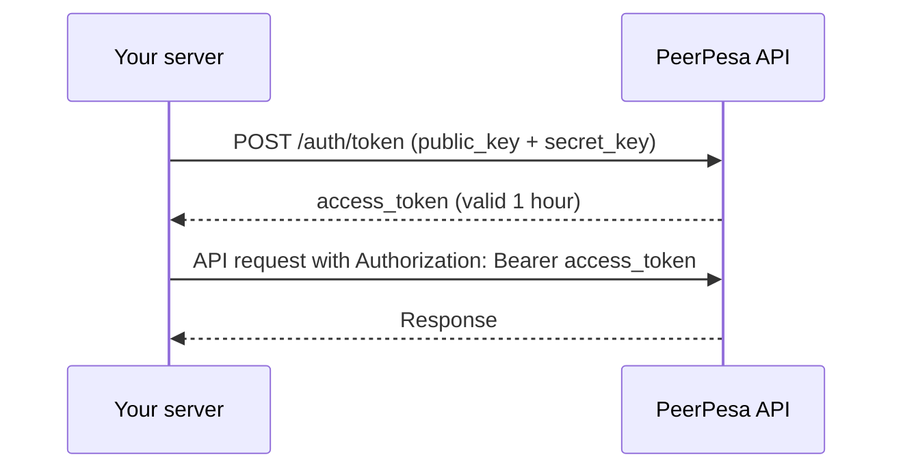

The PeerPesa API authorizes requests with an API key pair made up of a **public key** and a **secret key**. Your server exchanges the pair for a short-lived Bearer access token, then sends that token in the `Authorization` header on every call. This page explains how to generate keys, request tokens, and keep your credentials safe.

## How API keys work

Each API key pair has two parts that do different jobs:

| Credential | Prefix | Purpose | Can be shared? |
| --- | --- | --- | --- |
| Public key | `pk_test_` / `pk_live_` | Identifies your account and the key pair. Safe to show in logs and the dashboard. | Yes |
| Secret key | `sk_test_` / `sk_live_` | Proves the request comes from you. Used only to request access tokens. | No, keep it server-side |

The `test` prefix marks sandbox keys and the `live` prefix marks production keys. A sandbox key pair never works against production, and the reverse is also true.



## Generate an API key pair

<Info>
  You must complete [KYC verification](/kyc-verification) before you can generate API keys. Sandbox keys unlock after KYC approval; live keys also require approved production access.
</Info>

<Steps>
  <Step title="Sign in to the dashboard">
    Sign in to the PeerPesa dashboard. Use the sandbox dashboard for test keys and the production dashboard for live keys.
  </Step>
  <Step title="Open API Keys">
    Go to **Settings** > **API Keys** and select **Generate new key**.
  </Step>
  <Step title="Name the key">
    Give the key a descriptive label, such as `payouts-backend`, so you can identify it later when rotating or revoking.
  </Step>
  <Step title="Copy both keys">
    The dashboard shows the public key and the secret key. Copy the secret key immediately and store it in a secrets manager or environment variable.
  </Step>
</Steps>

<Warning>
  The secret key is shown **only once**. If you lose it, revoke the key pair and generate a new one. PeerPesa staff will never ask for your secret key.
</Warning>

Store the keys as environment variables on your server:

```bash .env
PEERPESA_PUBLIC_KEY=pk_live_3f9a2b7c1d...
PEERPESA_SECRET_KEY=sk_live_8e1d4c6a9b...
```

## Request an access token

Exchange your key pair for an access token with `POST /auth/token`.

<ParamField body="public_key" type="string" required>
  Your public key, starting with `pk_test_` or `pk_live_`.
</ParamField>

<ParamField body="secret_key" type="string" required>
  The secret key generated with the public key, starting with `sk_test_` or `sk_live_`.
</ParamField>

<CodeGroup>

```bash cURL
curl -X POST https://api.peerpesa.co/v1/auth/token \
  -H "Content-Type: application/json" \
  -d '{
    "public_key": "'"$PEERPESA_PUBLIC_KEY"'",
    "secret_key": "'"$PEERPESA_SECRET_KEY"'"
  }'
```

```javascript JavaScript
const res = await fetch("https://api.peerpesa.co/v1/auth/token", {
  method: "POST",
  headers: { "Content-Type": "application/json" },
  body: JSON.stringify({
    public_key: process.env.PEERPESA_PUBLIC_KEY,
    secret_key: process.env.PEERPESA_SECRET_KEY,
  }),
});
const { access_token, expires_in } = await res.json();
```

</CodeGroup>

```json Response
{
  "access_token": "eyJhbGciOiJIUzI1NiIsInR5cCI6IkpXVCJ9...",
  "token_type": "Bearer",
  "expires_in": 3600
}
```

<ResponseField name="access_token" type="string">
  Token to send in the `Authorization` header.
</ResponseField>

<ResponseField name="token_type" type="string">
  Always `Bearer`.
</ResponseField>

<ResponseField name="expires_in" type="integer">
  Seconds until the token expires. Defaults to `3600` (1 hour).
</ResponseField>

## Authorize API requests

Send the access token in the `Authorization` header on every request except `POST /auth/token`.

<CodeGroup>

```bash cURL
curl "https://api.peerpesa.co/v1/rates?type=onramp&network=stellar&asset=USDC&fiat_currency=KES" \
  -H "Authorization: Bearer $ACCESS_TOKEN"
```

```javascript JavaScript
const res = await fetch(
  "https://api.peerpesa.co/v1/rates?type=onramp&network=stellar&asset=USDC&fiat_currency=KES",
  { headers: { Authorization: `Bearer ${accessToken}` } }
);
```

</CodeGroup>

## Token expiry and renewal

Tokens expire after `expires_in` seconds. Requests with an expired or missing token return `401` with code `unauthorized`. There is no refresh token: request a new token with your key pair and retry. Cache the token and renew it a minute or two before it expires to avoid failed requests.

```javascript Token cache
let cached = { token: null, expiresAt: 0 };

async function getAccessToken() {
  if (cached.token && Date.now() < cached.expiresAt - 60_000) return cached.token;
  const res = await fetch("https://api.peerpesa.co/v1/auth/token", {
    method: "POST",
    headers: { "Content-Type": "application/json" },
    body: JSON.stringify({
      public_key: process.env.PEERPESA_PUBLIC_KEY,
      secret_key: process.env.PEERPESA_SECRET_KEY,
    }),
  });
  const { access_token, expires_in } = await res.json();
  cached = { token: access_token, expiresAt: Date.now() + expires_in * 1000 };
  return access_token;
}
```

## Rotate and revoke keys

- **Rotate**: generate a new key pair, deploy it to your servers, then revoke the old pair. Both pairs work until you revoke the old one, so rotation needs no downtime.
- **Revoke**: in **Settings** > **API Keys**, select the key and choose **Revoke**. Tokens issued from a revoked pair stop working immediately.

<Warning>
  If a secret key is exposed (committed to a repository, pasted in chat, or shipped in a client app), revoke it right away and generate a new pair.
</Warning>

## Authentication errors

| Status | Code | Cause | Fix |
| --- | --- | --- | --- |
| 400 | `invalid_request` | `public_key` or `secret_key` missing | Send both fields |
| 401 | `unauthorized` | Wrong key pair, revoked key, or expired token | Check keys, or request a new token |
| 401 | `unauthorized` | Sandbox key used against production (or the reverse) | Use the base URL that matches the key prefix |

## Environments

| Environment | Base URL | Key prefixes |
| --- | --- | --- |
| Sandbox | `https://sandbox-api.peerpesa.co/v1` | `pk_test_`, `sk_test_` |
| Production | `https://api.peerpesa.co/v1` | `pk_live_`, `sk_live_` |

Sandbox quotes and transactions never move real funds.
